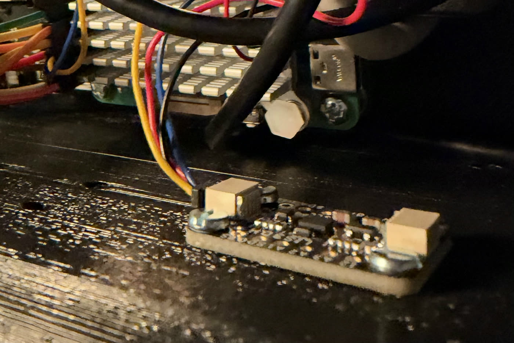

# LIS3DH Inclinometer Setup

OpenFlight can use an LIS3DH accelerometer mounted to the enclosure base to
measure whether the rig is level. The measured enclosure pitch is added to the
fixed IWR6843 antenna mounting angle for each shot.

This is an optional feature. It is disabled unless `--inclinometer` is passed.
The server flag requires `--iwr6843`; use the standalone tools when testing the
LIS3DH without the radar.

If the sensor is missing, moving, stale, or temporarily unreadable, OpenFlight
keeps the shot and uses the configured IWR6843 tilt without an enclosure
correction.

## What To Buy

The hardware used for the validated OpenFlight build is:

| Part | Product |
|------|---------|
| LIS3DH breakout | [Adafruit LIS3DH Triple-Axis Accelerometer, product 2809](https://www.adafruit.com/product/2809) |
| Solderless cable kit | [4-pin JST SH 1.0 mm STEMMA QT/Qwiic cable kit on Amazon](https://www.amazon.com/Connector-Compatible-Development-Sensors-Drivers/dp/B0GJPRX4YT) |
| Mounting | 2 (or 4) M2.5 heat-set inserts and M2.5 × 6 mm pan-head screws, for a floor bay of the [openflight-enclosure](https://github.com/open-flight/openflight-enclosure) shell |

The Amazon cable kit is the exact cable product used in this build. It includes
JST-SH-to-female-Dupont cables, so the breakout can connect directly to the
Raspberry Pi GPIO header without soldering pins onto the LIS3DH.

Do not buy a bare LIS3DH chip. Use a breakout board with the regulator, I2C
pull-ups, and STEMMA QT/Qwiic connectors already installed.

## How Compensation Works

The LIS3DH is mounted flat on the enclosure base, not on the tilted TI radar
board. OpenFlight keeps the three quantities separate:

```text
calibrated enclosure pitch = raw LIS3DH pitch + inclinometer zero offset
effective IWR tilt = configured IWR tilt + calibrated enclosure pitch
```

For the prototype installation:

- The IWR6843 antenna was measured at `11.5` degrees relative to the enclosure.
- A calibration surface measured `+0.1` degrees in the radar tilt direction.
- The resulting LIS3DH zero offset was approximately `+1.5` degrees.

Treat those as examples, not universal defaults. Measure each physical build.

## Power Down Before Wiring

Shut down the Pi and remove power before connecting or moving GPIO wires. A
misplaced 3.3 V lead can short the Pi, cause reboot loops or a black screen, and
potentially damage the Pi or sensor.

## Wiring

The two STEMMA QT connectors on the Adafruit LIS3DH are electrically identical.
Use whichever port gives the cable the cleanest route through the enclosure.

The purchased cable kit uses these colors:

| Cable color | Signal | Raspberry Pi physical pin | Pi signal |
|-------------|--------|---------------------------|-----------|
| Red | `VIN` / `3.3V` | **17** | 3.3 V power |
| Black | `GND` | **20** | Ground |
| Blue | `SDA` | **3** | GPIO2 / I2C SDA |
| Yellow | `SCL` | **5** | GPIO3 / I2C SCL |

```text
LIS3DH STEMMA QT                         Raspberry Pi GPIO header

Red     VIN / 3.3V  ------------------>  physical pin 17 (3.3V)
Black   GND         ------------------>  physical pin 20 (GND)
Blue    SDA         ------------------>  physical pin 3  (GPIO2/SDA)
Yellow  SCL         ------------------>  physical pin 5  (GPIO3/SCL)
```

> [!WARNING]
> Use physical pin numbers exactly as shown. GPIO/BCM numbers are a different
> numbering system. Do not connect the LIS3DH to a 5 V GPIO-header pin.

Cable colors are not a universal standard. If using a different cable, verify
each conductor against the breakout labels before powering the Pi.

The I2C bus can share Pi power and ground pins with other devices. It does not
need a dedicated 3.3 V or ground pin as long as the shared connection is secure.

## Mounting And Axis Direction

**Point the Y arrow on the board at the ball.** Then positive Y means the
enclosure is tilting back, which is the sign OpenFlight uses. Nothing needs to
be flipped in software.


### Where

Use the **left floor bay**, as seen from behind the rig looking downrange. The
shell has three Adafruit bays. On the new radar front, the IWR6843 sits closer
to the middle and leans back over the front pockets of the right bay and one
pocket of the middle bay, so you cannot get a screwdriver to them. The left bay
is fully clear.

Each bay has four Ø3.4 × 6 mm pockets on a 20.32 × 12.7 mm pattern, which
matches the Adafruit board's holes. Press M2.5 heat-set inserts in flush with
the floor. Two diagonal inserts hold the board; fill all four if you want.
Screw the board down with M2.5 × 6 mm pan-head screws.

Screw it flat against the floor. Avoid thick foam tape that lets the board flex
independently from the enclosure.

### Which way round

The Adafruit board has an axis mark printed next to the chip:

- **Y** points at the long edge with the **I2 / A3 / A2 / A1 / SDO / CS** pins.
  That edge faces the ball.
- **X** points along the board, between the two STEMMA QT connectors. In the
  left bay it points at the middle of the case.
- **Z** points up, out of the component side.

The **VIN / 3Vo / GND / SCL / SDA / INT** edge faces you. Plug the cable into
the STEMMA QT port on the right-hand side, which is nearer the Pi. Both ports
are identical.

X/roll is recorded but is not currently applied to the launch-angle correction.



### Check it

`scripts/setup/setup.sh` asks about the LIS3DH, enables I2C and runs this check.
To run it on its own:

```bash
uv run python scripts/hardware-test/check_lis3dh_orientation.py
```

It reads the sensor with the rig level, asks you to lift the front about
2-3 cm, and reads it again. With +Y toward the ball, pitch rises:

```text
OK: +Y points at the ball (pitch rose +9.8 deg when the front was lifted). No sign flip is needed.
```

If the board is reversed, turned sideways, upside down or not flat, the script
says so and how far to turn it.

## Enable I2C On The Pi

Enable the Pi header I2C interface and reboot:

```bash
sudo raspi-config nonint do_i2c 0
sudo reboot
```

After reconnecting over SSH, verify that bus 1 exists:

```bash
ls -l /dev/i2c-1
```

To scan the bus, install `i2c-tools` if needed and run:

```bash
sudo apt-get install -y i2c-tools
i2cdetect -y 1
```

The default LIS3DH address is `0x18`, so the scan should contain `18`:

```text
     0  1  2  3  4  5  6  7  8  9  a  b  c  d  e  f
10: -- -- -- -- -- -- -- -- 18 -- -- -- -- -- -- --
```

## Install Software

From the OpenFlight checkout:

```bash
uv sync
```

The Linux installation includes `smbus2`, which the LIS3DH driver uses to talk
to `/dev/i2c-1`.

## Verify Raw Readings

Run the standalone hardware readout before starting the full application:

```bash
uv run python scripts/hardware-test/read_lis3dh.py
```

Example output:

```text
LIS3DH detected on I2C-1 at 0x18
X=+0.001g  Y=-0.024g  Z=+0.974g  Raw=-1.41deg  Enclosure=-1.41deg
```

Useful options:

```bash
# Print 10 samples and exit
uv run python scripts/hardware-test/read_lis3dh.py --count 10

# Preview the calibrated enclosure and effective TI angles
uv run python scripts/hardware-test/read_lis3dh.py \
  --zero-offset-deg 1.5 \
  --iwr6843-tilt-deg 11.5

# Probe a non-default address while troubleshooting
uv run python scripts/hardware-test/read_lis3dh.py --address 0x19
```

## Calibrate The Zero Offset

The zero offset corrects only the LIS3DH's own mounting and sensor bias. It does
not include the TI board's fixed mounting angle.

1. Put the complete enclosure on a firm, stationary surface.
2. Measure that surface in the radar tilt direction with a phone level app.
3. Keep the enclosure still and run the calibration helper.
4. Pass the phone reading to `--reference-pitch`, including its sign.

For a surface measured at `+0.1` degrees:

```bash
uv run python scripts/hardware-test/calibrate_lis3dh.py --reference-pitch 0.1
```

The script averages 50 samples and prints a value such as:

```text
Raw pitch mean: -1.401deg (std dev 0.071deg)
Reference pitch: +0.100deg
Recommended flag: --inclinometer-zero-offset +1.501
```

Record that value in the launch command. The current implementation does not
write a calibration file.

## Measure The Fixed IWR6843 Tilt

Measure the TI antenna face relative to the enclosure base, not relative to the
floor under the rig. Pass that fixed mounting angle through
`--iwr6843-tilt-deg`.

For the prototype's measured `11.5` degree mounting angle:

```bash
--iwr6843-tilt-deg 11.5
```

Do not add the current floor slope to this number. The LIS3DH supplies that
runtime correction.

## Start OpenFlight

Example production startup:

```bash
scripts/start-kiosk.sh \
  --iwr6843 \
  --iwr6843-tilt-deg 11.5 \
  --inclinometer \
  --inclinometer-zero-offset 1.5
```

At startup, OpenFlight prints the raw enclosure pitch, calibrated pitch,
configured IWR tilt, and effective IWR tilt. It then samples the LIS3DH at 10 Hz.

For each shot, OpenFlight:

1. Selects the newest stable LIS3DH snapshot timestamped before impact.
2. Rejects snapshots after motion, sensor errors, or more than two seconds old.
3. Adds calibrated enclosure pitch to the configured IWR tilt.
4. Uses a per-shot copy of the IWR calibration so shared calibration is never
   mutated.
5. Continues with the configured IWR tilt if correction cannot be applied.

## Session Logging

The `session_start` entry records:

- Whether the inclinometer initialized.
- I2C bus and address.
- Sampling rate and zero offset.
- Startup reading or initialization error.

Each `shot_detected` entry records:

- Raw and calibrated pitch.
- X, Y, Z, and gravity magnitude.
- Reading timestamp and age at impact.
- Stability/application status.
- Configured and effective IWR tilt.

Common statuses are `stable`, `moving`, `stale`, `sensor_error`, and
`no_stable_preimpact_reading`.

## Troubleshooting

### Green LED Is On, But `0x18` Is Missing

The LED confirms power only. It does not prove SDA/SCL communication.

1. Confirm `/dev/i2c-1` exists.
2. Confirm I2C is enabled, then reboot.
3. Recheck blue to physical pin 3 and yellow to physical pin 5.
4. Confirm black is on ground and red is on 3.3 V.
5. Reseat both ends of the JST-SH cable.
6. Try the other identical STEMMA QT port on the LIS3DH.
7. Run `i2cdetect -y 1` again.

If the scan shows `0x19`, the board's address-selection input is pulled high.
Restore the default `0x18` configuration or use `--address 0x19` only with the
standalone readout while diagnosing it. The OpenFlight runtime currently expects
`0x18`.

### `WHO_AM_I expected 0x33`

OpenFlight reached an I2C device at the selected address, but it did not identify
as an LIS3DH. Check for another device using `0x18`, verify the breakout model,
and inspect the bus with `i2cdetect -y 1`.

### Permission Denied On `/dev/i2c-1`

Add the OpenFlight user to the `i2c` group, then log out and back in or reboot:

```bash
sudo usermod -aG i2c "$USER"
sudo reboot
```

### Pi Reboots, Shows A Black Screen, Or Runs The Fan At Full Speed

Power down immediately and inspect the GPIO connections. This commonly points
to a shifted connector, a power-to-ground short, or a wire on the wrong physical
pin. Remove the LIS3DH, confirm the Pi boots normally, and reconnect one signal
at a time with power removed.

### Pitch Sign Is Backward

Run `uv run python scripts/hardware-test/check_lis3dh_orientation.py`. If it
reports that +Y points at the golfer, turn the board 180° so the Y arrow and the
I2 / A1-A3 / SDO / CS pin row face the ball. A zero offset corrects bias; it
should not be used to hide a reversed axis.

### Pitch Is Noisy Or Shots Report `moving`

- Tighten the sensor mounting.
- Replace flexible foam tape with thin rigid tape or standoffs.
- Keep the cable from pulling on the breakout.
- Wait about one second after repositioning the rig before taking a shot.
- Check that gravity magnitude is close to `1.0g` in the readout.

### Shots Report `stale`

OpenFlight has not received a recent stable reading. Check the I2C connection,
sensor mounting, and logs for sample errors. The shot is still processed using
the configured IWR tilt.

### Effective Tilt Looks Wrong

Confirm the inputs have distinct meanings:

- `--iwr6843-tilt-deg`: TI antenna angle relative to the enclosure.
- `--inclinometer-zero-offset`: LIS3DH calibration bias.
- Runtime enclosure pitch: current enclosure angle relative to level.

Do not put the floor slope into `--iwr6843-tilt-deg`, and do not put the TI board
mounting angle into `--inclinometer-zero-offset`.

## Current Limitations

- Pitch compensation uses the LIS3DH Y direction.
- X/roll is logged but not yet applied to full 3D boresight compensation.
- Sensor bus, address, and calibration are command-line/runtime settings rather
  than a persisted rig configuration file.
