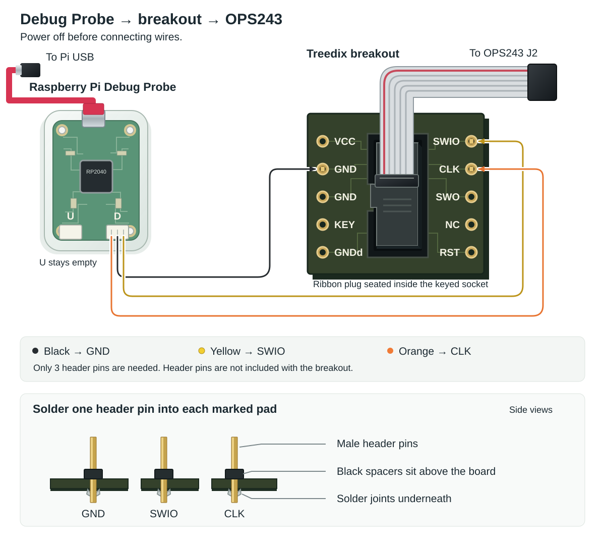

# Flash the OPS243-A to v1.3.3

For an **XMC4500 revision AC / 1 MiB OPS243-A**, with OpenFlight installed in
`~/openflight` on a Raspberry Pi. This guide uses the [GPIO UART wiring](ops243-uart.md).
Do not use it for XMC4700, OPS243-C or a board that requires JTAG.

> **Manufacturer confirmation pending:** The Raspberry Pi Debug Probe/OpenOCD
> procedure below worked on the tested board, but has **not yet been confirmed
> by OmniPreSense**. The SEGGER and UART/Memtool methods linked below are
> documented by the manufacturer.

## Choose the update method

Compare tools and costs on the [parts page](../get-started/parts.md#ops243-a-firmware-updates).
Firmware 1.3.2 already supports OpenFlight's internal hardware trigger; updating
to 1.3.3 also installs the bootloader needed for the UART method below.

- **Running firmware older than 1.3.3:** use the Debug Probe procedure below
  for the supported board. It installs v1.3.3, including its new bootloader.
  The manufacturer's alternative is **SEGGER J-Link with XMCFlasher**, described
  in [AN-013-G, pages 1–7](https://omnipresense.com/wp-content/uploads/2026/11/AN-013-G_Code-Update.pdf).
- **Already running v1.3.3 with its bootloader:** future firmware updates can use
  the manufacturer's **UART and Memtool** procedure in
  [AN-013-G, pages 8–12](https://omnipresense.com/wp-content/uploads/2026/11/AN-013-G_Code-Update.pdf).
  It uses [Infineon's free Memtool](https://softwaretools.infineon.com/tools/com.ifx.tb.tool.infineonmemtool)
  and a 3.3 V USB-to-UART adapter, such as [Adafruit 954](https://www.adafruit.com/product/954).
  The adapter connects directly to **J3**; no SWD breakout or J2 ribbon is needed.
  This route requires the bootloader to be installed already; it does not provide
  the first upgrade from an older firmware version.

**Keep the Debug Probe for future updates.** Its **U** port can serve as a
[3.3 V USB-to-TTL serial adapter](https://www.raspberrypi.com/documentation/microcontrollers/debug-probe.html),
providing the same TX/RX/GND function as a USB-to-serial TTL cable. Once
v1.3.3's bootloader is installed, the probe should therefore be reusable for
the UART method instead of buying another cable. The specific Debug Probe
and Memtool combination has **not been tested here**.

UART uses the **U** port wired directly to **J3**, with no SWD breakout or J2
ribbon, and a separate radar power connection because the U port supplies no
power. The procedure below uses the **D** port and J2 throughout.

## Tested setup

The successful hardware update used these versions. Other combinations have
not been validated by this guide.

| Component | Tested version |
| --- | --- |
| Host | Raspberry Pi 5, Raspberry Pi OS Trixie (Debian 13) |
| Radar | OPS243-A, XMC4500 revision AC, 1 MiB flash |
| OpenOCD package | `0.12.0+rpt20250909.cd4873400-1` |
| OpenOCD executable | `0.12.0+dev-snapshot (2026-02-16-16:07)` |
| Radar firmware | 1.3.0 → 1.3.3, build `20261016_1230` |

The probe firmware was updated before the successful flash; its exact version
and the Python version were not recorded. Use `python3 --version` and
`lsusb -v -d 2e8a:000c` to record them on your setup. The OpenOCD line
`CMSIS-DAP: FW Version = 2.0.0` identifies the protocol, not the probe firmware.

## 1. Get the parts

**Total cost: about $30 for the flashing parts below**, assuming you already
have the Pi, radar, soldering iron and solder.
These parts are for the SWD procedure. The breakout adapts the probe's three
signals to J2; a compatible direct SWD cable could replace it, but that cable
arrangement has not been validated here.

| Part / search terms | Included / needed | Example source |
| --- | --- | --- |
| Raspberry Pi Debug Probe, part SC0889 | USB cable and female-ended debug lead included | [Raspberry Pi distributors](https://www.raspberrypi.com/products/debug-probe/) / [Mouser](https://www.mouser.com/en/ProductDetail/Raspberry-Pi/SC0889?qs=amGC7iS6iy9zSCCLsPnjYw%3D%3D&mgh=1) |
| Cortex SWD/JTAG breakout: **10-pin (2 × 5), 1.27 mm pitch, keyed socket**, with accessible GND, SWDIO and SWCLK pads; matching female-to-female ribbon cable | The tested Treedix set includes the breakout and ribbon. Equivalent boards must use the standard Cortex 10-pin SWD pinout. | [Tested Treedix set](https://a.co/d/0iXOxKd0) or search those specifications at a local distributor |
| 3 male header pins, 2.54 mm pitch for the tested breakout | **Not included**; one each for GND, SWIO and CLK | Any electronics supplier |
| Soldering iron and solder | For attaching the three header pins | Any electronics supplier |
| 1 female-to-female jumper wire | OPS243 J3 pin 1 to Pi physical pin 13 | Any electronics supplier |

## 2. Install the tools and download the script

Use an **SSH terminal connected to the Pi**, or Terminal on the Pi desktop.
No Pi desktop is required for any of the update commands.

**Copy each box, press Enter, and wait for it to finish. Stop at the first
error and keep the output.** If asked for a password, type the Pi password;
it will not appear as you type.

```bash
sudo apt update
```

```bash
sudo apt install -y openocd python3 curl
```

```bash
mkdir -p ~/ops243-backup
```

Download the [script](https://github.com/open-flight/openflight/blob/main/scripts/setup/ops243_update.py):

```bash
curl --fail --location https://raw.githubusercontent.com/open-flight/openflight/main/scripts/setup/ops243_update.py --output ~/ops243-backup/ops243_update.py
```

This downloads the commands used below; no helper files are assumed to exist.
The script runs one requested step at a time and never starts flashing as part
of backup or preparation. Use this folder for **one radar only**. Keep any
existing original backup.

## 3. Update the Debug Probe over SSH

Keep the probe's **D cable disconnected** until step 4. If it is already
connected, shut down and unplug Pi/radar power before disconnecting it, then
power the Pi back on and reconnect over SSH.

```bash
python3 ~/ops243-backup/ops243_update.py probe
```

The script downloads the official **`debugprobe.uf2`**, then pauses:

1. Unplug the probe's USB cable and remove its top cover.
2. Hold **BOOTSEL** while plugging USB back into the **Pi**, then release it.
3. Press **Enter in the SSH terminal**.

The script finds the **RPI-RP2** drive, mounts it if needed and copies the
firmware. It refuses to copy if no matching drive or more than one is found.
The drive should disappear when the probe restarts. Unplug the probe and
replace its cover.

Check the restarted probe's firmware after reconnecting its USB to the Pi:

```bash
lsusb -v -d 2e8a:000c
```

Look for `bcdDevice`; for example, `2.31` means probe firmware **2.3.1**.
This uses Raspberry Pi's [BOOTSEL update method](https://www.raspberrypi.com/documentation/microcontrollers/debug-probe.html).
The mount/copy automation has been tested offline, not on another physical probe.

## 4. Solder and connect

Shut down the Pi and unplug its power. Disconnect any separate radar power.



1. Solder the three header pins onto the breakout's **GND, SWIO and CLK** pads.
   Check for solder bridges.
2. Plug the supplied debug lead into the probe's **D** port. Push its female
   ends onto the soldered header pins:

    | Probe lead | Breakout pin |
    | --- | --- |
    | Black | GND |
    | Yellow | SWIO |
    | Orange | CLK |

    On equivalent boards, **SWIO = SWDIO** (Cortex pin 2) and **CLK = SWCLK**
    (pin 4). Use ordinary **GND** (pin 3 or 5). Leave **SWO**, **GNDd** and
    the other breakout pins disconnected.

3. Connect the included ribbon cable from the breakout to the radar's **J2**
   connector. Match the connector key and pin-1 markings.
4. Keep the radar's micro-USB unplugged. Check these connections:

    | OPS243 connection | Raspberry Pi physical pin |
    | --- | --- |
    | J3 pin 9 — 5 V | 4 |
    | J3 pin 10 — GND | 14 |
    | **J3 pin 1 — v1.3.3 sampling signal** | **13 (GPIO27)** |

5. Connect the probe's USB cable to the Pi. Restore Pi power and reconnect over SSH.

## 5. Stop OpenFlight

If OpenFlight runs as a service:

```bash
sudo systemctl stop openflight
```

Otherwise, close OpenFlight or any other program using the radar.

## 6. Back up the radar

```bash
python3 ~/ops243-backup/ops243_update.py backup
```

The script uses the same OpenOCD backup sequence as the tested manual procedure.
It checks for **XMC4500 revision AC**, **1 MiB**, **12 unprotected sectors** and
**`contents match`**. It refuses to overwrite an existing original backup.

Continue only when it prints **`Backup complete: 1 MiB read and verified.`**
The message also reminds you to copy the backup before continuing.

Copy these files from `~/ops243-backup` to another computer:

- `ops243-before-update.bin`
- `backup-sha256.txt`

To copy over SSH, open a terminal **on your desktop**, in the folder where you
want to keep the files. Replace `PI_USER` and `PI_IP` with your Pi username and
IP address, then run:

```bash
scp PI_USER@PI_IP:~/ops243-backup/ops243-before-update.bin .
```

```bash
scp PI_USER@PI_IP:~/ops243-backup/backup-sha256.txt .
```

Return to the **Pi's SSH terminal** for the remaining steps.

## 7. Download and prepare v1.3.3

```bash
python3 ~/ops243-backup/ops243_update.py prepare
```

This downloads the same pinned OmniPreSense v1.3.3 HEX used in the tested
update, checks its SHA-256 and prepares the files from your original backup.
It does not access the radar. Continue only when you see:

```text
Prepared v1.3.3; original backup retained. Settings area: 65,536 bytes unchanged.
```

## 8. Flash the radar

Keep power and cables connected. Allow about four minutes.

```bash
python3 ~/ops243-backup/ops243_update.py flash
```

The script checks the prepared files again, then runs the **same OpenOCD
command sequence and write order** as the successful manual update. It first
compares the live radar with the original backup, writes the application and
first block, then verifies the entire 1 MiB. The output must include:

```text
contents match
wrote 393216 bytes from file ops243-app.bin
wrote 65536 bytes from file ops243-first64k.bin
contents match
shutdown command invoked
Flash complete: full 1 MiB verified.
```

The final message also reminds you to power off before disconnecting the probe.
The **second `contents match`**, after both writes, verifies the complete flash.
The sequence retains `reset run`, the one-second wait and `halt 0`;
`reset init` and `reset halt` timed out in this setup.

If flashing fails, leave power and cables connected. Keep the backup and
`ops243-flash.log`. The script records the attempt in `flash-attempted.txt`
and refuses a second attempt; do not delete the marker or blindly rerun after
a partial write. Ask for help using the saved output.

## 9. Power off and disconnect the probe

```bash
sudo poweroff
```

1. Wait for the Pi to shut down.
2. Physically unplug Pi power and any separate radar power.
3. Disconnect the probe's D cable from the breakout.
4. Restore Pi power and wait for startup.

## 10. Check the version

Open Terminal again, or reconnect over SSH. Stop the OpenFlight service if used:

```bash
sudo systemctl stop openflight
```

Open your OpenFlight folder:

```bash
cd ~/openflight
```

Run the version check using OpenFlight's Python environment:

```bash
uv run python ~/ops243-backup/ops243_update.py version
```

Continue only when you see:

```text
OPS243 firmware: 1.3.3
```

Restart the OpenFlight service:

```bash
sudo systemctl start openflight
```

If you start OpenFlight manually, open it as usual. Check normal radar readings
and keep the original backup permanently.

## How the procedure preserves settings

[AN-013-G](https://omnipresense.com/wp-content/uploads/2026/11/AN-013-G_Code-Update.pdf)
warns that XMCFlasher's **Erase** button clears factory and persistent settings.
The two OpenOCD commands above erase selected sectors for their separate binary
files. Their address ranges leave a 64 KiB gap:

| Address range, inclusive | Action |
| --- | --- |
| `0x0C000000–0x0C00FFFF` | Erase/write `ops243-first64k.bin` (65,536 bytes) |
| **`0x0C010000–0x0C01FFFF`** | **Settings storage: excluded from both writes** |
| `0x0C020000–0x0C07FFFF` | Erase/write `ops243-app.bin` (393,216 bytes) |

Analysis of the pinned v1.3.3 firmware traced its factory-settings and
persistent-settings routines to this gap. It matches the region reserved by
[Infineon's XMC4000 emulated EEPROM library](https://infineon.github.io/mtb-xmc-emeeprom/xmc4_em_eeprom_api_reference_manual/html/index.html).
This address identification comes from firmware analysis, not an OmniPreSense
calibration map.

The preparation starts with the original backup and overlays only the vendor's
HEX data. The script checks that every other byte remains unchanged.
The final OpenOCD comparison checks the entire 1 MiB against that merged image.

For the tested radar, offline analysis of the original backup and expected image
found all **65,536 settings bytes identical**, including three saved records at
`0x0C018000`, `0x0C019000` and `0x0C01A000` with valid CRCs. The successful
whole-bank hardware verification establishes that these original bytes were
intact immediately after flashing. This establishes storage preservation; it
does not identify every calibration field or check changes made by running
firmware after reboot. Keep the full original backup.

For the identified frequency-tuning and cosine-correction fields, record
offsets and analysis limits, see the [partial settings map](ops243-settings-analysis.md).
