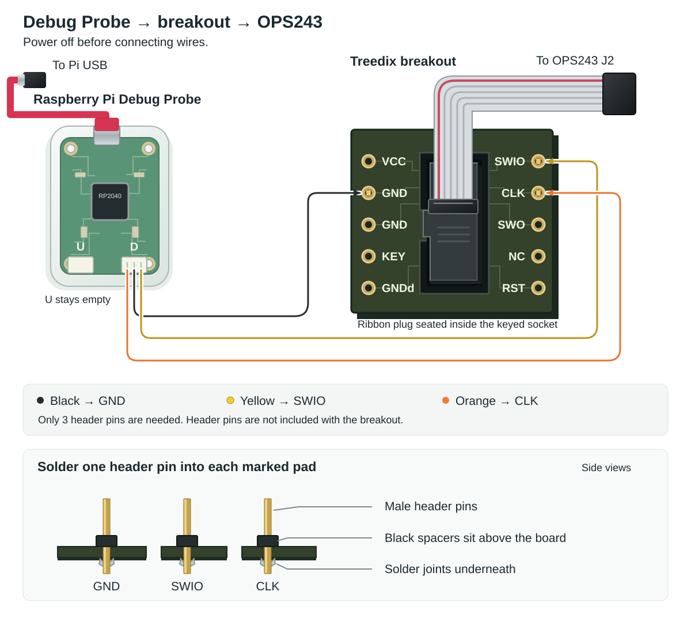

# Flash the OPS243-A to v1.3.3

For an **XMC4500 revision AC / 1 MiB OPS243-A**, with OpenFlight installed in
`~/openflight` on a Raspberry Pi. This guide uses the [GPIO UART wiring](ops243-uart.md).
Do not use it for XMC4700, OPS243-C or a board that requires JTAG.

## 1. Get the parts

**Total cost: about $30 for the flashing parts below**, assuming you already
have the Pi, radar, soldering iron and solder.

| Part | Included / needed |
| --- | --- |
| [Raspberry Pi Debug Probe](https://www.mouser.com/en/ProductDetail/Raspberry-Pi/SC0889?qs=amGC7iS6iy9zSCCLsPnjYw%3D%3D&mgh=1) | USB cable and female-ended debug lead included |
| [Treedix breakout board](https://a.co/d/0iXOxKd0) | Ribbon cable included |
| 3 header pins | **Not included**; one each for GND, SWIO and CLK |
| Soldering iron and solder | For attaching the three header pins |
| 1 female-to-female jumper wire | OPS243 J3 pin 1 to Pi physical pin 13 |

## 2. Update the Debug Probe

Do this on your computer before connecting the probe to the radar.

1. Unplug Pi and radar power. Disconnect the probe's USB and D cables.
2. Open the [official Debug Probe releases](https://github.com/raspberrypi/debugprobe/releases/latest).
   Under **Assets**, download **`debugprobe.uf2`**.
3. Remove the probe's top cover to reach the **BOOTSEL** button.
4. Hold **BOOTSEL** while plugging the probe's USB into your computer.
   Release it when the **RPI-RP2** drive appears.
5. Open **RPI-RP2** and drag **`debugprobe.uf2`** onto it.
6. Wait for the drive to disappear. The probe has restarted with its updated firmware.
7. Unplug the probe's USB and replace the cover.

## 3. Solder and connect

Shut down the Pi and unplug its power. Disconnect any separate radar power.



1. Solder the three header pins onto the breakout's **GND, SWIO and CLK** pads.
   Check for solder bridges.
2. Plug the supplied debug lead into the probe's **D** port. Push its female
   ends onto the soldered header pins:

    | Probe lead | Breakout pin |
    | --- | --- |
    | Black | GND |
    | Yellow | SWIO |
    | Orange | CLK |

    Leave the other breakout pins disconnected.

3. Connect the included ribbon cable from the breakout to the radar's **J2**
   connector. Match the connector key and pin-1 markings.
4. Keep the radar's micro-USB unplugged. Check these connections:

    | OPS243 connection | Raspberry Pi physical pin |
    | --- | --- |
    | J3 pin 9 — 5 V | 4 |
    | J3 pin 10 — GND | 14 |
    | **J3 pin 1 — v1.3.3 sampling signal** | **13 (GPIO27)** |

5. Connect the probe's USB cable to the Pi. Restore Pi power.

## 4. Open Terminal and install the tools

On the Pi desktop, click **Terminal**. If using SSH, use the terminal connected
to your Pi.

**Copy each box in full, paste it into Terminal, press Enter, and wait.**
Include the final `PY` line when shown. If asked for a password, type the Pi
password and press Enter; it will not appear as you type.

**Stop at the first error. Keep the output so you can ask for help.**

Update the package list:

```bash
sudo apt update
```

Install the tools:

```bash
sudo apt install -y openocd python3
```

Create the working folder:

```bash
mkdir -p ~/ops243-backup
```

Open it:

```bash
cd ~/ops243-backup
```

Use this folder for one radar. Keep any existing original backup.

## 5. Stop OpenFlight

If OpenFlight runs as a service:

```bash
sudo systemctl stop openflight
```

Otherwise, close OpenFlight or any other program using the radar.

## 6. Back up the radar

Stay in `~/ops243-backup`. Copy this entire box:

```bash
test ! -e ops243-before-update.bin && \
sudo openocd -f interface/cmsis-dap.cfg \
  -c "transport select swd" \
  -f target/xmc4xxx.cfg \
  -c "adapter speed 1000" \
  -c "init" \
  -c "poll" \
  -c "halt 0" \
  -c "wait_halt 5000" \
  -c "flash probe 0" \
  -c "flash info 0" \
  -c "flash read_bank 0 ops243-before-update.bin" \
  -c "flash verify_bank 0 ops243-before-update.bin" \
  -c "resume" \
  -c "shutdown"
```

Continue only if the output includes all four lines below and every displayed
sector is **unprotected**:

```text
XMC4500 - Rev: AC
size 0x00100000
wrote 1048576 bytes to file ops243-before-update.bin
contents match
```

If nothing runs, the backup file may already exist. Stop; do not delete or
replace it.

In the Pi's File Manager, open **Home → ops243-backup**. Copy
**`ops243-before-update.bin`** to a USB drive or another computer before continuing.
Keep the Terminal open in the same folder.

## 7. Download and prepare v1.3.3

Copy the whole box, from `python3` through the final `PY`. It downloads the
firmware, checks it, and prepares the files using your backup.

```bash
python3 - <<'PY'
from pathlib import Path
from urllib.request import urlopen
import hashlib

original = Path("ops243-before-update.bin").read_bytes()
assert len(original) == 1048576, "Backup must be exactly 1 MiB"
url = (
    "https://raw.githubusercontent.com/omnipresense/OPS243-A_Firmware/"
    "efaceefb8fa547071cb925c0d20d2e38363ace67/"
    "OPS243_CW_v1.3.3_20261016_1230.hex"
)
raw = urlopen(url, timeout=60).read()
expected_hash = (
    "169a6c6c7ae14bcc7da3e7201e31c623"
    "149da65e9f3df7598da70e0ae3e9d81c"
)
assert hashlib.sha256(raw).hexdigest() == expected_hash, "Wrong HEX file"
image = bytearray(original)
base = 0
written = 0
for line in raw.decode("ascii").splitlines():
    r = bytes.fromhex(line[1:])
    n, kind = r[0], r[3]
    data = r[4:4+n]
    assert len(r) == n+5 and sum(r) % 256 == 0, "Invalid HEX record"
    if kind == 4:
        base = int.from_bytes(data, "big") << 16
    elif kind == 0:
        offset = base + int.from_bytes(r[1:3], "big") - 0x0C000000
        assert 0 <= offset <= len(image)-n, "Address outside flash"
        image[offset:offset+n] = data
        written += n
    elif kind == 1:
        break
    elif kind != 5:
        raise ValueError("Unexpected HEX record")
assert written == 286768, "Unexpected firmware size"
Path("OPS243-v1.3.3.hex").write_bytes(raw)
Path("ops243-first64k.bin").write_bytes(image[:0x10000])
Path("ops243-app.bin").write_bytes(image[0x20000:0x80000])
Path("ops243-expected.bin").write_bytes(image)
print("Prepared v1.3.3; original backup retained.")
PY
```

Continue only when it prints this with no error:

```text
Prepared v1.3.3; original backup retained.
```

Stay in the same Terminal and folder. Do not change the generated files.

## 8. Flash the radar

Keep power and cables connected. Allow about four minutes. Copy the whole box:

```bash
sudo openocd -f interface/cmsis-dap.cfg \
  -c "transport select swd" \
  -f target/xmc4xxx.cfg \
  -c "adapter speed 1000" \
  -c "init" \
  -c "poll" \
  -c "reset run" \
  -c "sleep 1000" \
  -c "poll" \
  -c "halt 0" \
  -c "wait_halt 5000" \
  -c "flash probe 0" \
  -c "flash verify_bank 0 ops243-before-update.bin" \
  -c "flash write_image erase ops243-app.bin 0x0C020000 bin" \
  -c "flash write_image erase ops243-first64k.bin 0x0C000000 bin" \
  -c "flash verify_bank 0 ops243-expected.bin" \
  -c "shutdown"
```

Continue only when these messages appear in this order:

```text
contents match
wrote 393216 bytes from file ops243-app.bin
wrote 65536 bytes from file ops243-first64k.bin
contents match
shutdown command invoked
```

Require the **second `contents match`**, after both writes. It verifies the
complete flash. Keep the command as shown; `reset init` and `reset halt` timed
out in this setup.

If flashing fails, leave power and cables connected. Keep the backup and error
output. Do not rerun the flashing block after a partial write.

## 9. Power off and disconnect the probe

```bash
sudo poweroff
```

1. Wait for the Pi to shut down.
2. Physically unplug Pi power and any separate radar power.
3. Disconnect the probe's D cable from the breakout.
4. Restore Pi power and wait for startup.

## 10. Check the version

Open Terminal again, or reconnect over SSH. Stop the OpenFlight service if used:

```bash
sudo systemctl stop openflight
```

Open your OpenFlight folder:

```bash
cd ~/openflight
```

Copy this whole box, including the final `PY`:

```bash
uv run python - <<'PY'
import sys
sys.path.insert(0, "src")
from openflight.ops243 import OPS243Radar
radar = OPS243Radar(port="/dev/ttyAMA0")
try:
    radar.connect()
    print("OPS243 firmware:", radar.get_firmware_version())
finally:
    radar.disconnect()
PY
```

Continue only when you see:

```text
OPS243 firmware: 1.3.3
```

Restart the OpenFlight service:

```bash
sudo systemctl start openflight
```

If you start OpenFlight manually, open it as usual. Check normal radar readings
and keep the original backup permanently.
