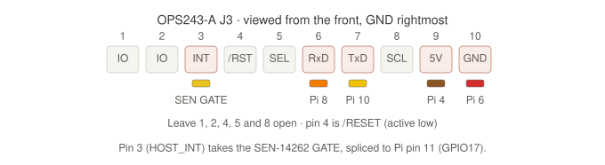

# Moving the OPS243 from USB to the Pi GPIO UART

Step-by-step migration for taking the OPS243-A off USB and onto the Pi's
40-pin header, plus how to prove it still works before anything else changes.

## Why

The Pi cannot power two radars over USB. The TI IWR6843 needs a USB port and
real current; moving the OPS243 to the GPIO header takes it off the USB bus
entirely — 5V from a header pin instead of a port, and data over the J3 UART.
The total draw from the power supply is unchanged; what you gain is escaping
the per-port USB current limit and the shared controller.

Do this migration on its own and validate it. Adding the TI radar at the same
time makes any failure ambiguous.

> **Non-WiFi OPS243 only.** On a WiFi-equipped OPS243-A the onboard module
> already drives the radar's UART receive line, so J3 pin 6 cannot be used and
> the server could never send configuration or re-arm commands. Use a
> separately powered USB hub instead — see
> [Option B in the IWR6843 guide](../iwr6843/index.md).

## What changes in software

Baud. Over USB CDC-ACM the host baud setting is nominal; over the J3 UART it
is the real wire rate, and the factory default is 19,200. One rolling-buffer
dump is 40,556 bytes:

| Baud | Dump transfer |
|---|---|
| 19,200 (factory default) | 21.1 s — every capture truncated |
| 115,200 | 3.5 s |
| **230,400 (`I5`, what we use)** | **1.8 s** |

So `connect()` probes for the rate the board is actually talking at and raises
it to 230,400. You don't have to configure this; it happens automatically when
`--radar-port` names a UART device. Everything else — the sound trigger, the
rolling buffer, HOST_INT — is unchanged.

## 1. Power down

```bash
sudo shutdown -h now
```

Wait for the Pi to stop, then remove its power. Never change GPIO wiring on a
powered Pi.

## 2. Wire it

Unplug the OPS243 micro-USB cable and leave it unplugged. Per AN-010-AD,
enumerating USB shuts off UART reporting entirely — with the cable in, the
UART stays silent and looks like a wiring fault.

The J3 header is the 10-pin header on the OPS243-A. Confirm the pin-1 marker
on the board before counting.

| OPS243 J3 | Signal | Pi physical pin | Pi signal |
|---|---|---|---|
| Pin 9 | `5V` | 2 or 4 | 5V |
| Pin 10 | `GND` | 6 (or any GND) | GND |
| Pin 7 | `TxD` (out) | 10 | GPIO15 / `RXD0` |
| Pin 6 | `RxD` (in) | 8 | GPIO14 / `TXD0` |
| Pin 3 | `HOST_INT` | 11, through the `GATE` splice | sound detector `GATE` and GPIO17 |

![OPS243 UART wiring with the SEN-14262 sound trigger: the radar, drawn with its J3 pins pointing up and the micro-USB to their left, runs from the Raspberry Pi 5 header with 5V on J3 pin 9 to Pi pin 4, ground on J3 pin 10 to Pi pin 6, and a crossed UART pair on J3 pins 7 and 6 to Pi pins 10 and 8. The sound detector runs on 3.3V from Pi pin 1 with ground on Pi pin 9, and its GATE output is spliced to J3 pin 3 (HOST_INT) and Pi pin 11 (GPIO17). The Pi is rotated so its USB ports face up and the header runs down its left edge; of its two ribbon connectors, CAM/DISP 1, nearer the USB ports, takes the camera and CAM/DISP 0, below it, takes the Touch Display 2.](../assets/ops243-uart-wiring.svg)

*The diagram picks physical pin 4 for 5V, pin 6 for the radar's ground and pin
9 for the sound detector's; any 5V and any GND pin work as long as all boards
share the same ground rail. For orientation it also labels the two ribbon
connectors: a camera on CAM/DISP 1 needs `dtoverlay=ov9281,cam1` in
`/boot/firmware/config.txt`, and the Touch Display 2 on CAM/DISP 0 is detected
automatically.*

The full header map for this build, with the sound detector, the LIS3DH,
display power and the UPS pogo pins:


The OPS243-A J3 header from the front:



TX and RX are **crossed**: the radar's transmit goes to the Pi's receive, and
the Pi's transmit goes to the radar's receive. Getting pin 6 wrong is the
quiet failure — the radar still talks, so you get readings at 19,200 baud, but
it never receives the command to go faster.

The sound trigger is unchanged: `GATE` still drives `HOST_INT` directly, and
that hardware path is still what dumps the rolling buffer. Keep the SEN-14262
on Pi 3.3V and the shared ground.

Ground is now load-bearing twice over: J3 pin 10 is both the UART return path
and the trigger's voltage reference. All three boards share it.

Never connect 5V to a GPIO signal pin.

### Wiring checklist

- [ ] OPS243 micro-USB unplugged
- [ ] J3 pin 9 → Pi pin 2 or 4 (5V)
- [ ] J3 pin 10 → Pi GND, shared with the sound detector
- [ ] J3 pin 7 → Pi pin 10 (GPIO15 / RXD0)
- [ ] J3 pin 6 → Pi pin 8 (GPIO14 / TXD0)
- [ ] J3 pin 3 → SEN-14262 `GATE` (unchanged)
- [ ] No 5V on any GPIO signal pin

## 3. Prepare the Pi UART

Power the Pi back up (the radar now powers up with it) and enable the UART:

```bash
sudo raspi-config
```

`Interface Options` → `Serial Port`, then:

1. Login shell over serial: **No**
2. Serial port hardware: **Yes**
3. Reboot

Disabling the login shell is not cosmetic. If a console holds the port, its
boot output is transmitted into the radar's RxD pin and parsed as API
commands — `A` followed by `!` is a flash write.

Confirm the device and that nothing else claims it:

```bash
ls -l /dev/ttyAMA0
grep -o 'console=serial0[^ ]*' /boot/firmware/cmdline.txt      # must print nothing
grep -E "enable_uart|dtparam=uart0" /boot/firmware/config.txt  # expect enable_uart=1 or dtparam=uart0=on
```

Note for Raspberry Pi 5 & Newer OS Versions:
Modern Pi OS (Debian Bookworm) and Pi 5 hardware use dtparam=uart0=on instead of the legacy enable_uart=1 setting to enable the UART0 hardware block.

On a Pi 5 the 40-pin header is `/dev/ttyAMA0`. Do **not** use `/dev/serial0`,
which points at `/dev/ttyAMA10` — the separate debug-header UART.

## 4. Validate, in this order

Each step assumes the previous one passed. Stop at the first failure; running
later steps against a broken transport just produces confusing output.

### 4a. Transport, baud, and trigger path

```bash
uv run python scripts/hardware-test/diagnose.py --ops-port /dev/ttyAMA0
```

This is the whole migration check in one command. It verifies the environment
(device present, no serial console, OPS USB not enumerated), connects and
negotiates baud, confirms the radar still boots into rolling-buffer mode,
takes a software capture, and — when you clap — exercises the sound trigger
end to end.

What you want to see:

```
[2/7] OPS243 connectivity ................... ✓ PASS
        /dev/ttyAMA0 • firmware 1.5.2 • 230400 baud • dump ~2.0s
[4/7] OPS243 software trigger ............... ✓ PASS
        Capture received: 4096 I/Q samples • 40556 bytes in 1.83s (22.2 KB/s)
```

`230400 baud` and ~22 KB/s are the numbers that prove the migration worked. A
pass reporting 19,200 is reported as a failure on purpose — it means the radar
never received the `I5` command, so check the Pi pin 8 → J3 pin 6 wire.

### 4b. Repeated shots

```bash
uv run python scripts/hardware-test/test_rolling_buffer_persist.py --test \
  --port /dev/ttyAMA0
```

Clap or hit balls. Each capture prints its transfer time, so you can confirm
the rate holds up shot after shot rather than only on the first one.

If it reports no triggers at all, the rolling-buffer mode saved in flash may
have been lost — re-run the one-time setup (below) and power cycle.

### 4c. The real thing

```bash
scripts/start-kiosk.sh --radar-port /dev/ttyAMA0
```

Hit shots and confirm ball speed, club speed, and spin still land in the UI.
The session log records the negotiated baud in its `connection` entry.

## Re-running the one-time rolling-buffer setup

Only needed if the radar has lost its persisted rolling-buffer mode (symptom:
no hardware triggers at all, or the diagnostic reporting CW-mode streaming).

The base procedure is [Rolling buffer setup](../setup/rolling-buffer.md); over
UART it differs in two ways — an explicit `--port`, and a different way to
power-cycle:

```bash
uv run python scripts/hardware-test/test_rolling_buffer_persist.py --setup \
  --port /dev/ttyAMA0
```

The power cycle it asks for is now the 5V jumper on J3 pin 9 — there is no USB
cable to pull and no reset line wired. Disconnect pin 9, wait 3 seconds,
reconnect it, leaving TX/RX and ground in place. Then re-run with `--test`.

Because the negotiated baud is already active when the settings are saved,
`A!` will also persist 230,400 if the firmware supports it — in which case
subsequent connects find the right rate on the first probe instead of stepping
down to 19,200 and back up.

## Troubleshooting

| Symptom | Likely cause |
|---|---|
| `No reply from OPS243 ... at any of` | OPS micro-USB still plugged in (silences the UART), TX/RX not crossed, no 5V on J3 pin 9, or no shared ground |
| Connects, but at 19,200 baud | Pi pin 8 → J3 pin 6 missing or wrong. The radar can talk but not listen, so it never gets `I5` |
| `/dev/ttyAMA0` does not exist | `enable_uart=1` missing from `/boot/firmware/config.txt`, or you're looking for `/dev/serial0` on a Pi 5 |
| Radar behaves erratically after boot | Serial console still enabled on the port — its output is being parsed as API commands |
| Permission denied | User not in `dialout`: `sudo usermod -aG dialout $USER`, then log out and back in |
| Captures parse-fail intermittently | Dropped bytes: the J3 UART has no flow control. Try `--ops-baud 115200` |

## Falling back to USB

Nothing is one-way. Plug the micro-USB cable back in, remove the 5V/TX/RX
jumpers (leave `GATE` → `HOST_INT` and the shared ground), and drop
`--radar-port`. Auto-detect finds the USB device again.

## See also

- [Sound trigger wiring](sound-trigger.md) — the `GATE` → `HOST_INT` path
- [IWR6843 integration](../iwr6843/index.md) — adding the TI radar afterwards
- [Raspberry Pi setup](../setup/raspberry-pi.md) — base OS configuration
