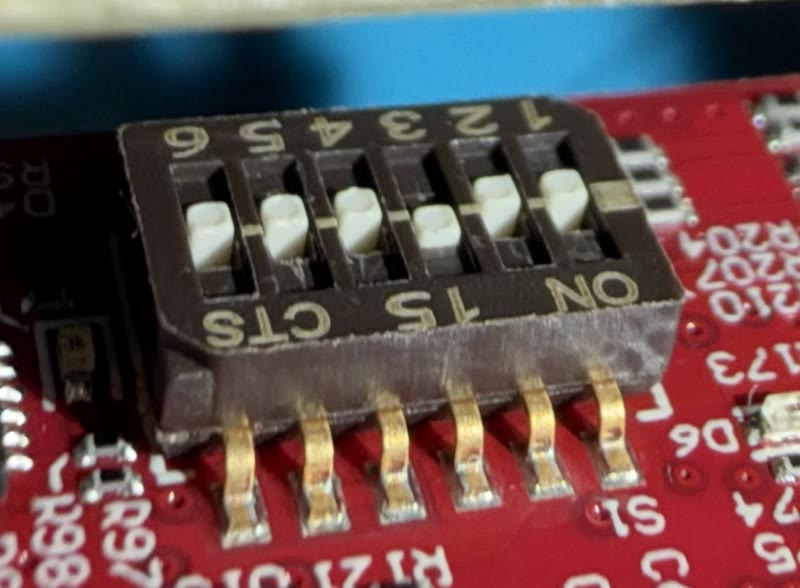

# Flash the Firmware

The stock TI demo does not expose the raw radar cube OpenFlight needs. A
validated prebuilt image ships in `firmware/releases/`, so flashing does not
require the TI toolchain — see the
[firmware developer guide](../development/firmware.md) only if you want to
build from source.

## Flash The IWR6843 Firmware

The recommended method flashes directly from the Pi using the checked-in ROM
bootloader client. TI UniFlash is a fallback, not a requirement.

### 1. Stop Serial Users

Stop OpenFlight, calibration, `shot_test.py`, and any other process using the TI
port. Use `Ctrl+C` in the terminal that launched OpenFlight, then check for
remaining owners:

```bash
pgrep -af 'openflight|calibrate|shot_test'
sudo fuser -v /dev/ttyUSB0
```

Do not flash until the Enhanced UART is free.

### 2. Enter Flash Mode

Set the IWR6843LEVM boot switches to:

```text
S1.1 ON, S1.2 OFF, S1.3 ON, S1.4 ON, S1.5 OFF
```

![IWR6843LEVM boot switch S1 as seen on the mounted board, with its markings drawn upside down as they appear from this side: lever numbers 6 to 1 run left to right along the top, so S1.1 is at the right end, and the bottom edge by the solder legs reads CTS, 15 and ON, with ON under lever 1; the board silkscreen S1 sits beside the legs. A lever pushed down, toward ON, is on. Flashing: S1.1 on, S1.2 off, S1.3 on, S1.4 on, S1.5 off. Functional: S1.1 off, S1.2 off, S1.3 on, S1.4 on, S1.5 off. Only S1.1 changes; S1.6 is not used.](../assets/iwr6843-s1-boot-switch.svg)

*S1 is a six-lever DIP switch, drawn as it faces you on the mounted board, where
its print reads upside down: `ON · 15 · CTS` along the edge by the solder legs and
`1`–`6` along the other. S1.1 is the lever next to `ON`, and a lever pushed toward
`ON` is on. Only S1.1 moves between flashing and
normal use. RESET is the S2 push button on the board.*



*The same switch on a mounted board, for matching the diagram to the part.*

Do not press RESET yet. The flashing script opens the UART first and tells you
when to reset the board.

### 3. Probe The ROM Bootloader

Run the non-destructive probe:

```bash
uv run python firmware/flash_iwr6843.py \
  --probe \
  --port /dev/ttyUSB0
```

Follow the prompts exactly:

1. Type `READY` so the script opens the UART and settles its control lines.
2. Press and release RESET only when the script asks.
3. Wait one second.
4. Type `PROBE`.

The expected result is:

```text
IWR6843 ROM bootloader handshake: PASS
```

If you are flashing immediately, leave the board in flash mode. The flash
command will ask for another RESET after it opens the UART.

### 4. Flash The Configurable Image

```bash
uv run python firmware/flash_iwr6843.py \
  firmware/releases/l3_dump_configurable_capture_20260818.bin \
  --port /dev/ttyUSB0
```

Follow the `READY` -> RESET -> one-second wait -> `FLASH` sequence shown by the
script. The default operation erases the existing serial flash, writes the
image in acknowledged chunks, closes it, and asks the ROM bootloader to verify
the result.

A successful flash ends with:

```text
Erasing existing SFLASH...
Opening firmware image...
Writing firmware...
Writing: 100% (.../... bytes)
Closing and verifying firmware...

Flash verified by the IWR6843 ROM bootloader.
```

Do not reset, disconnect, or remove power while the erase or write is active.
An erase can take longer than ten seconds.

### 5. Return To Functional Mode

Set the switches to (the lower row of the diagram in step 2):

```text
S1.1 OFF, S1.2 OFF, S1.3 ON, S1.4 ON, S1.5 OFF
```

Press and release RESET. The custom firmware is now ready for OpenFlight.

