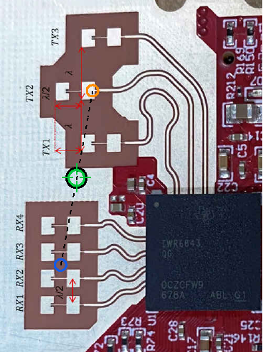

# Mount, Aim, and Measure

Where the radar sits and how it is angled determines every launch angle it
reports. The numbers you measure here go straight into the runtime.

## Mount And Aim The Radar

- Mount the radar behind the ball, antenna face pointing down the target line,
  with the TX antennas above the RX antennas.
- Start with about 10° of upward tilt, like the OPS243, then measure the actual
  tilt of the antenna face and enter that.
- Keep the antenna face unobstructed and the mount rigid: small shifts show up
  as angle bias.
- Re-measure after moving to a different floor, mat, bay or stand.

A corner reflector on the target line can check horizontal aim, but it does not
replace validation with real shots.

**Give the ball as much flight as you can.** The radar can only track the ball
until it hits the net or leaves the radar's range. The longer that flight, the
more frames the radar gets of the ball, and in theory the better the reading.
So place the unit and the tee to leave as much room to the net as the space
allows. For the same reason, an outdoor range should in theory read better than
a net indoors. On the `feat/iwr-self-trigger` branch, tell it which with
`--iwr6843-flight range` or `net`.

## Measure The Geometry

!!! danger "Measure your own unit. The defaults are from the old enclosure."

    The defaults (`tee-m` 1.575, `net-m` 4.6, radar height 0.1524 m, tilt
    10.40°, ball height 0.040 m) were measured on the validated rig, in the old
    enclosure on a stand. On the current case they are wrong: a unit on its
    feet has its antenna about 0.050 m up, not 0.1524. Wrong geometry does not
    raise an error, it just gives biased launch angles or no ball tracks at
    all. Put your values in your start script, and check them again whenever
    the unit, the mat or the bay changes.

Every distance and height starts at the **antenna center** (the green
crosshair), and both heights use the floor the ball sits on.

| Argument | Measure |
|---|---|
| `--iwr6843-tee-m` | Antenna center → ball center, along the target line |
| `--iwr6843-net-m` | Antenna center → net (not ball → net) |
| `--iwr6843-radar-height-m` | Floor → antenna center (not the board center or the case bottom) |
| `--iwr6843-ball-height-m` | Same floor → ball center: mat height + 0.021 m |
| `--iwr6843-tilt-deg` | Antenna-face tilt from vertical, with an inclinometer |

### Which point to measure from

The antenna center is the middle of the virtual array: halfway between the
center of the four RX patches and the center of the three TX patches, in the
gap between the two groups (TI
[SWRU585](https://www.ti.com/lit/pdf/SWRU585), Figures 4-1 and 4-2). It is not
the middle of the board.

*TI SWRU585 Figure 4-1 (© 2021 Texas Instruments), turned to the mounted
orientation. The green crosshair is the midpoint of the RX (blue) and TX
(orange) centers.*

On the current radar front (`Front-Radar-No-Fill`,
[openflight-enclosure#12](https://github.com/open-flight/openflight-enclosure/pull/12)),
the CAD puts the antenna center:

- **45.3 mm above the case bottom** (50.3 mm with the printed feet). One unit
  measured 52.5 mm with a ruler
  ([#339](https://github.com/open-flight/openflight/issues/339)), so measure
  yours.
- **27 mm behind the front face** at antenna height. Tape `tee-m` and `net-m`
  from the front face, directly in front of the IWR (not the bottom lip), and
  add 27 mm.
- **46.4 mm from the case's left side**, seen from the front. The target line
  runs through this point.

!!! note "On the `feat/iwr-self-trigger` branch"

    There, `tee-m` and `net-m` are taped from the front face and the software
    adds the depth itself, so do **not** add the 27 mm.

The tilt can also come from the phone app; see
[Calibrate TI radar tilt with the phone](../ios-ble.md#calibrate-ti-radar-tilt-with-the-phone).
`--iwr6843-tilt-deg` wins over the saved phone value, which wins over the
calibration JSON.

The checked-in reference calibration's array correction is a starting point
from the validated radar, not a factory calibration. A different board or
antenna orientation may need a new corner-reflector array calibration.
